<div align="center">

<picture>
  <source media="(prefers-color-scheme: dark)" srcset=".github/assets/banner-dark.svg">
  
</picture>

**Privacy-safe product analytics for PAM Native.**<br>
Firebase Analytics with no advertising identifiers: ad signals stay denied and screens are reported only when you say so.

[](https://packagist.org/packages/pushinbr/pam-native-analytics)
[](https://github.com/push-in/pam-native-analytics/releases/latest)

[](https://github.com/push-in/pam-native-analytics/actions/workflows/ci.yml)
[](LICENSE)

[Install](#install) · [Quick example](#quick-example) · [Platforms](#platform-support) · [Permissions](#requirements) · [Docs](#docs) · [Issues](https://github.com/push-in/pam-native-analytics/issues)

</div>

<a id="install"></a>
## <picture></picture> Install

Inside a PAM Native project, add only this capability:

```sh
pam composer require pushinbr/pam-native-analytics
pam doctor --fix
```

New to PAM? Create a project with `pam init my-app --template native` (see the [PAM Native overview](https://push-in.github.io/pam-docs/native/overview/)), then come back here. Composer owns the manifest and the lockfile; `pam composer` runs it on PAM's verified PHP runtime.

<a id="quick-example"></a>
## <picture></picture> Quick example

```php
<?php

use Pam\Native\Analytics\Analytics;

Analytics::setConsent();                 // analytics storage granted; ad_* always denied
Analytics::setCollectionEnabled(true);   // collection starts disabled
Analytics::logEvent('content_share', ['post_type' => 1, 'share_channel' => 2]);
Analytics::setScreen('Inbox');           // screen_view (screen_name = screen_class)
```

Every call is fire-and-forget. The optional completion receives `AnalyticsOperationState`: `Succeeded`, `Failed` or `Unavailable`.

<a id="platform-support"></a>
## <picture></picture> Platform support

| Platform | Support | Notes |
| --- | --- | --- |
| Android | API 26+ | firebase-analytics 23.2.0, firebase-common 22.2.0 |
| iOS | 15.0+ | firebase-ios-sdk 12.17.0: `FirebaseAnalyticsCore`, `FirebaseCore` |
| PAM Native | 1.0.0 to < 2.0.0 | From `pam-native.plugin.json`; PHP 8.5+ |

<a id="requirements"></a>
## <picture></picture> Permissions and requirements

| Platform | Declared by the plugin |
| --- | --- |
| Android | `android.permission.ACCESS_NETWORK_STATE`, `android.permission.INTERNET`, `android.permission.WAKE_LOCK` |
| iOS | No usage descriptions; `Info.plist` keys turn off automatic collection, screen reporting, IDFV and ad-network registration |

The plugin reuses the project's Firebase configuration: `google-services.json` on Android and `GoogleService-Info.plist` on iOS, which the host already uses for push. Without it every call is a silent no-op that answers `Unavailable`.

<a id="privacy"></a>
## <picture></picture> Privacy

- Android drops `AD_ID`, `ACCESS_ADSERVICES_AD_ID` and `ACCESS_ADSERVICES_ATTRIBUTION`, and disables ADID/SSAID collection.
- iOS links `FirebaseAnalyticsCore` (no IDFA support) and disables IDFV collection and ad-network registration.
- Ad storage, ad user data and ad personalization are denied by default and stay denied: `setConsent()` cannot grant them.
- Automatic screen reporting is off. Screens come only from `setScreen()`.
- Event and parameter names follow the Analytics limits: up to 40 characters, at most 25 parameters, text values cut to 100 characters, and no `firebase_`, `google_` or `ga_` prefixes.

<a id="with-pam-native-firebase"></a>
## <picture></picture> With pam-native-firebase

`pushinbr/pam-native-firebase` links the `FirebaseAnalytics` Swift product, which pulls `GoogleAppMeasurement` with `GoogleAppMeasurementIdentitySupport` (IDFA) and `GoogleAdsOnDeviceConversion`. Swift Package Manager links the union of both plugins' products, so an app that installs both ships IDFA support on iOS and this plugin's "no IDFA" guarantee no longer holds. Both plugins also drive the same `Analytics` singleton, so collection and consent set by one apply to the other.

- Android stays clean: this plugin's manifest removes the AD_ID and AdServices permissions and disables ADID/SSAID for the whole merged app.
- iOS: use this plugin alone for analytics, or keep `pam-native-firebase` without its `FirebaseAnalytics` product (switch it to `FirebaseAnalyticsCore`). Do not ship both products in one app.

<a id="tests"></a>
## <picture></picture> Tests

`composer test`. Without `vendor/`, point `PAM_NATIVE_SRC` and `PAM_NATIVE_TESTING_SRC` at the framework and testing sources.

<a id="docs"></a>
## <picture></picture> Docs

- [PAM Native overview](https://push-in.github.io/pam-docs/native/overview/)
- [PAM introduction](https://push-in.github.io/pam-docs/introduction/)
- [Changelog](CHANGELOG.md)
- [Report an issue](https://github.com/push-in/pam-native-analytics/issues)

<a id="pam-ecosystem"></a>
## <picture></picture> Part of the PAM ecosystem

<p align="center"><picture>
  <source media="(prefers-color-scheme: dark)" srcset=".github/assets/pam-wordmark-dark.svg">
  
</picture></p>

PAM runs PHP natively on servers, desktops and phones. This repository is one piece of it.

| [**PAM**](https://github.com/push-in/pam) | [**PAM Desktop**](https://github.com/push-in/pam-desktop) | [**PAM Native**](https://github.com/push-in/pam-native) | [**Ecosystem**](https://github.com/push-in/pam#ecosystem) |
| --- | --- | --- | --- |
| the runtime and CLI | native desktop apps in PHP | native Android and iOS apps in PHP | every official package and plugin |

<sub>Docs: [push-in.github.io/pam-docs](https://push-in.github.io/pam-docs/introduction/) · [Issues](https://github.com/push-in/pam-native-analytics/issues)</sub>

<p align="center"><sub><a href="LICENSE">Apache License 2.0</a> · Made in Brazil by Pushin</sub></p>
